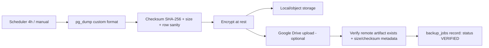

# Backup & Recovery

## 1. Scope & honest retention disclosure
Two distinct things: **(a) platform database backup** (whole PostgreSQL, platform-operated) and
**(b) tenant data export** (one tenant's data, tenant-admin requested). A tenant can never
access another tenant's backup or export.

Default schedule: database backup **every 4 hours**. Default retention keeps the **latest 18
successful backups ≈ 3 days** at that interval — this is disclosed in the UI exactly in those
terms (short window!). Recommended/optional tiers: daily retained 30 days, weekly retained 12
weeks (tenant/platform configurable). RPO ≈ 4h (default), RTO target ≤ 4h (Q-013 to confirm).

## 2. Backup pipeline

A backup counts as successful **only after** artifact verification (checksum recorded; for
Drive: remote file id + size confirmed). Statuses: `scheduled/running/uploaded/verified/failed`.
Failures retry with backoff (3 attempts) then alert platform admins + in-app notification;
a "stale backup" monitor alerts when no verified backup exists within 2× interval.

## 3. Google Drive integration
OAuth 2.0 authorization by the platform operator (or per-tenant for tenant exports),
tokens encrypted in secret store, least-privilege scope (`drive.file`), folder per environment.
Never store Google credentials/tokens in git or logs. Upload resumable for large dumps;
disconnect/revoke flow documented; Drive is a **copy**, local/object copy remains authoritative
until Drive verification passes.

## 4. Restore (platform-only, guarded)
Restore is **not** exposed to tenant admins. Procedure: platform owner + second approver →
maintenance mode → snapshot current DB → restore into isolated instance → integrity checks
(balance checks, journal balance validation, tenant row counts) → promote or abort.
Every restore is audit-logged with reason/ticket. **Restore drills:** quarterly (minimum:
before any production launch) restore the latest backup into an isolated environment and run
the reconciliation checks in `REPORTING_SPECIFICATION.md`; drill results recorded in PROGRESS/ops log.

## 5. Tenant export
Tenant admin (permission `tenant.export`) requests export (documents/ledgers as XLSX/PDF +
JSON data package); generated async, tenant-scoped signed download link (expiring), audited.
Deletion workflow per `PLATFORM_ADMIN.md` §5 (legal holds override deletion).
