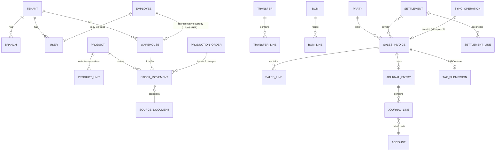

# Domain Model

Conventions: every tenant-owned table has `tenant_id` (FK → `tenants`), `id UUID PK`,
`created_at/updated_at timestamptz`, `created_by/updated_by`. Money: `NUMERIC(19,4)`.
Quantities: `NUMERIC(19,6)`. Tax rates: `NUMERIC(9,6)`. Soft-state via status fields;
posted financial rows are never deleted. Names below are canonical (English code names,
Arabic UI labels in `UX_AND_DESIGN_SYSTEM.md` glossary).

## Entity map (Mermaid)

## Core entities

### Platform (no tenant_id)
`tenants`, `subscription_plans`, `tenant_subscriptions`, `platform_users`,
`platform_audit_log`, `backup_jobs`, `feature_flags` / `tenant_entitlements`.

### Identity & org (tenant)
`users` (login, Argon2id hash, status), `roles`, `permissions`, `user_roles`,
`role_permissions`, `employees` (optional link `user_id`), `devices` (registered rep devices,
revocable), `branches`, `fiscal_years`, `accounting_periods` (open/closed, closed_by/at).

### Accounting
`account_groups`, `accounts` (code unique per tenant, type: asset/liability/equity/revenue/expense),
`account_mappings` (purpose → account, e.g. `SALES_REVENUE`, `VAT_OUTPUT`, `INVENTORY`, `COGS`,
`CASH_ON_HAND`, `REP_CUSTODY_CLEARING`… — the **only** source of posting accounts),
`journal_entries` (status draft/approved/posted/reversed, `reversal_of_id`, source doc ref,
period, idempotency key unique per tenant), `journal_lines` (account, debit, credit, dimensions:
branch/warehouse/representative/cost_center/project, party).

### Parties, products, pricing
`parties` (kind customer/supplier/both, tax number, classification, credit limit, terms, hold flag),
`party_contacts`, `party_addresses`, `payment_allocations` (receipt ↔ invoice, amount),
`products` (SKU/barcode unique per tenant, AR/EN names, category, brand, costing method,
lot/expiry flags, tax category), `units_of_measure`, `product_units` (conversion to stock unit),
`price_lists`, `price_list_items` (effective-dated), `customer_prices`, `pricing_policies`
(min/max, rep bounds, discount limits, free-goods thresholds).

### Inventory
`warehouses` (kind: main/branch/representative/quarantine/damaged, `employee_id` when REP),
`stock_movements` (**append-only ledger**: product, warehouse, qty signed in stock unit, unit cost,
movement type, lot, expiry, source document type+id, idempotency key unique),
`stock_balances` (derived cache: product×warehouse×lot, qty, value; reconcilable to ledger),
`lots` (lot code, expiry, product), `reservations`, `transfers` + `transfer_lines`
(status draft/dispatched/in_transit/partially_received/received/disputed/closed/cancelled,
expected vs received vs disputed qty), `stock_counts` + `stock_count_lines`,
`inventory_adjustments` (reason damage/expiry/missing/quarantine, approval state).

### Sales / purchasing / cash
`sales_invoices` + `sales_lines` (see status axes below; line: qty, free_qty, unit price,
original price, discount, override approval ref, tax category/rate, lot),
`sales_returns`/`credit_notes`, `debit_notes` (all linked `original_invoice_id`),
`purchase_orders`, `goods_receipts`, `supplier_invoices`, `purchase_returns`,
`payments` (method cash/bank/electronic, `settlement_status` for electronic:
pending/settled/failed/chargeback), `cashboxes`, `bank_accounts`, `cash_movements`,
`bank_reconciliations`, `expenses` (category, attachment refs, approval state, paid-from).

### Manufacturing
`boms` + `bom_lines` (ingredient, qty per unit, waste %), `production_orders`
(planned/actual, status), `production_cost_components` (labour/overhead),
`scrap_records` (normal/abnormal, disposition).

### Representative & settlement
`representative_profiles` (employee, warehouse, branch/customer/product scope, price policy),
`custody_snapshots` (opening expected stock/cash per settlement period — derived, cached),
`settlements` + `settlement_lines` (expected vs counted per product/cash/payment type,
discrepancy, exception status), `settlement_exceptions` (investigation, decision, approver,
resulting adjustment doc ref — never auto employee debt).

### Tax
`tax_registrations` (seller legal identity, VAT number, effective dates),
`tax_categories`, `tax_rates`, `invoice_tax_summaries`,
`tax_submissions` (invoice ref, environment sandbox/production, UUID, submission id,
status history, request/response metadata hashes, QR payload, crypto stamp — **only from real
ZATCA responses**), `zatca_credentials` (encrypted refs, never plaintext in DB dumps/logs).

### Sync, jobs, audit, AI
`sync_operations` (client op id unique per tenant+device, payload hash, status
received/applied/rejected/conflict, resulting document id), `outbox_events`,
`background_jobs` (type, payload, attempts, next_retry_at, status, last error),
`notifications`, `audit_log` (actor, action, entity, before/after JSON, ip, device),
`ai_provider_configs` (encrypted key ref), `ai_conversations`, `ai_tool_calls` (tool, args hash,
result summary, approval state).

## Document status axes (never collapse into one field)

| Axis | Example values |
|---|---|
| Commercial | draft → issued → partially_returned → returned / cancelled(pre-post only) |
| Inventory | none → reserved → dispatched/posted → reversed |
| Accounting | unposted → posted → reversed |
| Payment | unpaid → partially_paid → paid → advance/credit balance |
| Tax | not_required → pending_clearance/reporting → cleared/reported → rejected → corrected |
| Sync (field docs) | local_only → pending → syncing → synced / rejected / conflict |

## Business invariants (enforced; test-mapped in `TESTING_AND_ACCEPTANCE.md`)

1. Every posted journal balances (Σdebit = Σcredit) — DB constraint + service check.
2. A financial operation cannot post twice (unique idempotency key / unique source-doc link).
3. Posted documents immutable; correction only via reversal/credit/debit note linked to original.
4. Reversal at most once per entry; reversal itself is a posted, linked entry.
5. Stock movements cannot duplicate on sync retry (unique sync op id / movement idempotency key).
6. `stock_balances` always reconcile to Σ `stock_movements`; reconciliation job must report 0 drift.
7. A transfer receives at most the dispatched qty per line; cannot close with unresolved dispute (unless approved exception).
8. AR/AP subledger balances reconcile to party statements; allocations ≤ outstanding unless advance is recorded as such.
9. Free-goods lines carry stock-out + cost like paid lines; tax per configured policy only.
10. Tax status independent of accounting status; a draft is never a tax invoice.
11. No posting into a closed period; no duplicate posted document numbers.
12. Tenant isolation: every query scoped by `tenant_id`; RLS backstop.
13. Missing mapping/tax/cost input ⇒ explicit `ConfigurationError`, nothing posted.
14. Settlement finalization requires all configured gates; concurrent finalization impossible (row lock).
15. Shortage → exception record only; employee receivable requires separate approved decision (Q-004).

## Terminology (AR-first glossary, extract)

| Code term | العربية | English note |
|---|---|---|
| journal entry | قيد محاسبي | posted = مُرحَّل |
| draft | مسودة | never a tax invoice |
| representative | مندوب مبيعات | van-sales rep |
| custody | عهدة | stock+cash held by rep |
| settlement | تسوية / تصفية العهدة | shift closure workflow |
| free goods | بضاعة مجانية (بونص) | explicit line, not zero-price trick |
| transfer | تحويل مخزني | dispatch/receive workflow |
| credit note | إشعار دائن | linked to original invoice |
