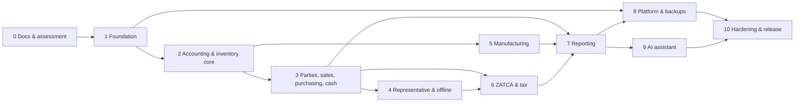

# Implementation Roadmap

Dependency-ordered. A phase starts only when its dependencies pass their gates
(`TESTING_AND_ACCEPTANCE.md`). Status values live in `PROGRESS.md` only.

## Phase 0 — Repository assessment & documentation (current)
Deliverables: repo assessment, `docs/` package (19 files), decision log with open questions,
this roadmap. **Gate:** docs internally consistent; owner notified of Q-IDs. No app code.

## Phase 1 — Technical foundation
Monorepo scaffold (api/web/shared), config & env validation, Postgres + Prisma migrations
baseline, tenancy (context + RLS), auth (Argon2id, sessions, MFA-ready), RBAC guards,
audit log, structured logging, health endpoints, outbox/job skeleton, CI (lint/type/unit/
integration), seed (platform admin, CoA template). Gate: AT-SEC-001/002 skeleton green.

## Phase 2 — Accounting & inventory foundations
Accounts/groups/mappings, journal engine (balance, reversal, periods, numbering), products/UoM,
warehouses, movement ledger + balances + reconciliation job, costing (moving average),
availability & concurrency control. Gate: AT-ACC-*, AT-INV-001/002, AT-DATE-001.

## Phase 3 — Customers, suppliers, sales, purchasing, cash & banks
Parties/credit/statements, pricing engine & overrides, back-office POS + Save dialog (draft/post),
purchasing cycle, payments & allocation, cashboxes/banks/expenses (tax module stubbed behind
policy config until Phase 6 — postings requiring tax config block explicitly, never guess).
Gate: AT-SALE-*, AT-PRICE-*.

## Phase 4 — Representative workflow
Provisioning (AT-REP-*), transfers, rep PWA (offline outbox, sync protocol, limits, dashboard),
collections/expenses in field, settlement & exceptions (AT-SET-*), commissions (basic rules).
Gate: AT-OFF-*, AT-TRF-*.

## Phase 5 — Production & advanced inventory
BOM, production orders, WIP costing, scrap, lot/expiry/FEFO, traceability, count workflows.
Gate: AT-MFG-*, inventory reports reconcile.

## Phase 6 — Electronic invoicing & ZATCA
Tax config UI/validation, XML/signing/QR strictly per official SDK, sandbox onboarding,
clearance/reporting, status tracking, retry/recovery, tax reports. Gate: AT-TAX-* in sandbox;
**legal review sign-off before any production enablement** (Q-001/Q-002). Not "certified" by
code alone.

## Phase 7 — Reporting & dashboards
All reports in `REPORTING_SPECIFICATION.md` with drill-down + exports; role dashboards;
reconciliation monitors. Gate: AT-RPT-001.

## Phase 8 — Platform administration & backups
Console, plans/entitlements/quotas enforcement, tenant lifecycle, support access, backups
(4h/18-retention default, Drive, verification, restore drill). Gate: AT-PLAT-001, AT-BAK-001.

## Phase 9 — AI assistant
Provider config, read tools, anomaly summaries, approval-gated drafts, audit. Gate: AT-AI-001.

## Phase 10 — UX completion, hardening, release readiness
RTL/bilingual QA pass, accessibility, security review (isolation/IDOR/authZ matrix), performance
& concurrency load tests, restore drill, E2E acceptance, deployment + rollback runbooks,
evidence-based release-readiness report (explicitly listing any unverified compliance claims).

## Rules
Never edit applied migrations; add new ones. Update owning docs + DECISIONS.md with any change.
No phase marked complete on code alone — tests + docs + PROGRESS evidence required.
