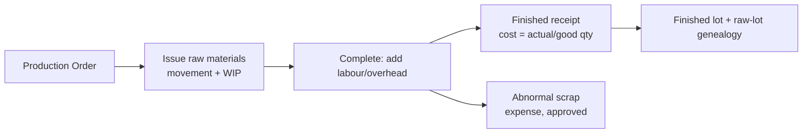

# Inventory & Costing

## 1. Authoritative ledger
`stock_movements` is append-only and authoritative: (product, warehouse, signed qty in **stock
unit**, unit cost, value, lot/expiry, movement type, source document, idempotency key, actor,
business date). `stock_balances` is a derived cache updated in the same transaction;
a reconciliation job recomputes balances from movements and alerts on any drift (invariant 6).

Movement types: `opening, purchase_receipt, purchase_return, sale, sale_return, transfer_out,
transfer_in, production_issue, production_receipt, scrap, damage, expiry_writeoff, count_adjustment,
quarantine_in/out, rep_dispatch(=transfer_out), rep_return`.

## 2. Units
All ledger quantities stored in the product's stock unit. Document lines may use purchase/sales
units; conversion via `product_units.factor_to_stock` (Decimal, validated > 0) at posting.
Fractional stock units (kg) fully supported (`NUMERIC(19,6)`).

## 3. Costing policy
- Default: **moving weighted average** per product × warehouse (recalculated on each receipt:
  `new_avg = (old_value + in_value) / (old_qty + in_qty)`; issues valued at current avg).
- Alternative per-tenant/product policy: **FIFO layers** (lot-aware). Policy is set before first
  movement for a product; changing it later requires a documented, audited revaluation procedure
  (Q-007). One product = one method at a time — no mixing.
- Landed costs (freight/customs on a purchase) allocate to received lines by value (default)
  or quantity (config), increasing unit cost; allocation recorded and reversible with the receipt.
- Negative/zero-qty edge: issues blocked when insufficient available stock unless explicit
  tenant config `allow_negative_stock` + permission `inventory.negative_stock` (default off);
  cost of an issue with zero on-hand under that exception uses last known average and is flagged.

## 4. Availability & concurrency
Available = on_hand − reserved. Posting a sale/transfer-out checks availability and decrements
via conditional update / `SELECT … FOR UPDATE` on the balance row inside the posting transaction.
Two concurrent postings cannot both consume the same stock (AT-INV-… concurrency test).

## 5. Warehouses & transfers
Warehouse kinds: main, branch, representative (custody), quarantine, damaged.
Transfer lifecycle: `draft → dispatched(in_transit) → partially_received/received →
closed`, with `disputed` quantities per line (expected vs received vs disputed + reason).
Stock leaves source at dispatch (in-transit is represented by source-out movement +
pending receipt state; custody availability follows tenant policy `rep_stock_available_on`:
`dispatch` or `acceptance` — default `acceptance`, Q-008). Receipt creates the in-movement
exactly once (unique constraint on transfer+line receipt). Discrepancies route to the
accountant; resolution = accept-shortage (approved adjustment), return-to-source, or recount.

## 6. Lots, expiry, FEFO
Lot-tracked products require lot+expiry on receipts/production; sales pick suggestion FEFO
(earliest expiry), override logged with reason. Expiry report + quarantine flow for expired
stock; expired stock cannot be sold (hard block when lot expired, unless admin policy says otherwise — default block).

## 7. Counts & adjustments
Physical count freezes nothing by default; count lines record counted qty; variance
(counted − book) posts only via approved `inventory_adjustment` with reason
(damage/expiry/missing/quarantine/found). Adjustment posts stock movement + journal
(Dr/Cr Inventory vs configured loss/gain account). Unapproved variances change nothing.

## 8. Returns inspection
Customer returns land in quarantine/damaged warehouse first; inspection decision moves them
to sellable (same lot if valid), damaged, or scrap — each a movement. Cost-in = original sale cost.

## 9. Free goods
Free lines move stock out and relieve inventory at cost (Dr configured free-goods/COGS account).
Quantity counted separately (`free_qty`) everywhere in reporting. Tax treatment: policy-driven
(`INVOICING_AND_ZATCA.md` §5, Q-003) — never assumed.

## 10. Manufacturing costing
BOM standard quantities (+ waste %) → production order issues raw at current cost (movement),
accumulates WIP (raw + labour + overhead components actually recorded). Finished receipt unit
cost = `total_actual_cost / good_qty` (good = accepted finished qty). **Normal** waste cost is
absorbed into good qty cost; **abnormal** waste/scrap is expensed to `SCRAP_LOSS` with approval
and does not inflate finished cost. If any required cost input/mapping is missing at completion,
final costing is blocked with an explicit error — cost is never silently 0. Variance
(planned vs actual) reported per order; lot genealogy: finished lot records consumed raw lots
(traceability/recall).

