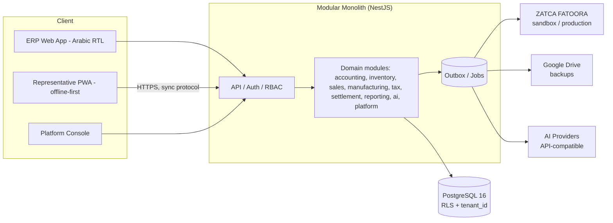

# System Architecture

## Decision summary (see `DECISIONS.md` for rationale & alternatives)

- **Modular monolith** (one deployable API) with strict module boundaries — no microservices
  until a demonstrated need exists.
- **PostgreSQL 16** primary database. **TypeScript / Node 22 LTS** everywhere.
- API: **NestJS** (modules per domain, server-side authorization guards, transactions).
- Web: **React + Vite + TypeScript**, one codebase, role-based shells for ERP / representative
  PWA / platform console; installable PWA with service worker + IndexedDB outbox.
- ORM/migrations: **Prisma Migrate** (versioned migrations; raw SQL when RLS/constraints need it).
- Money: Prisma `Decimal` / `NUMERIC`; **never** JS `number` for money or quantities.
- Jobs: DB-backed transactional outbox + job table first (retry/backoff/observability);
  Redis/BullMQ only if measured need appears (D-006).
- Tests: Vitest (unit), integration tests against real PostgreSQL, Playwright (E2E/PWA offline).

No existing code existed to reuse (greenfield, D-001) — this stack is chosen for one-language
maintainability, Decimal support, PWA fit, and hiring/maintenance simplicity for a small team.

## Topology

## Module boundaries (API)

| Module | Owns | Must not |
|---|---|---|
| `identity` | users, roles, permissions, devices, sessions | business posting |
| `tenancy` | tenant context, RLS session, entitlements | — |
| `accounting` | accounts, mappings, journals, periods | read UI-only state |
| `inventory` | warehouses, movement ledger, balances, transfers, counts | price/tax decisions |
| `catalog` | products, units, price lists, pricing policy | stock mutation |
| `parties` | customers/suppliers, credit, statements | journal internals (uses accounting svc) |
| `sales` | invoices, POS, returns, payments allocation | duplicate posting logic |
| `purchasing` | PO, receipts, supplier invoices | direct stock writes (uses inventory svc) |
| `manufacturing` | BOM, production, costing, scrap | silent zero costing |
| `cash` | cashboxes, banks, expenses, reconciliation | treating unsettled e-pay as cash |
| `representatives` | profiles, custody, settlement | auto employee-debt posting |
| `tax` | tax config, ZATCA adapter, submissions | inventing endpoints/stamps |
| `sync` | device sync protocol, idempotency, conflicts | bypassing domain validation |
| `reporting` | read models/queries over ledgers | writing business data |
| `notifications` | in-app notifications, delivery | — |
| `ai` | provider adapters, tool registry, approvals | arbitrary SQL / direct DB writes |
| `platform` | tenants, plans, quotas, backups, health | implicit tenant-data access |
| `audit` | audit log writes/reads | mutable history |

**Single-authority rule:** invoice posting, stock movement, and journal creation exist **only**
in `sales`/`inventory`/`accounting` domain services. ERP POS, rep POS, reporting, tax, and AI
all call those services. No module re-implements them.

## Cross-cutting contracts

- **Tenant context:** resolved from authenticated session (never from client-supplied tenant id);
  set per-request; Postgres RLS `SET LOCAL app.tenant_id` as backstop.
- **Transactions:** posting operations run in one DB transaction covering document + stock
  movements + journal + tax-submission-intent + outbox event.
- **Idempotency:** every mutating command accepts `Idempotency-Key`; unique
  `(tenant_id, idempotency_key)`; replay returns the original result, never re-executes.
- **Errors:** typed errors (`ValidationError`, `ConfigurationError`, `InsufficientStock`,
  `CreditLimitExceeded`, `PeriodClosed`, `ConflictError`) with Arabic user messages + codes.
- **Audit:** mutations write `audit_log` in the same transaction where feasible.
- **Config:** environment variables + secret store; per-tenant settings in DB; ZATCA sandbox
  and production credentials strictly separated; nothing secret in git.
- **Time:** store `timestamptz` UTC; business date derived with tenant time zone rules
  (`ACCOUNTING_POLICY.md` §7).
- **API style:** REST JSON `/api/v1/...`, OpenAPI generated, versioned; sync endpoints separate
  (`/api/v1/sync/...`) per `OFFLINE_SYNC.md`.
- **Health/observability:** `/health` (liveness), `/health/ready` (DB/jobs), structured JSON logs
  with request id + tenant id (no secrets/PII payloads), metrics counters for jobs/sync/tax.

## Deployment

- Environments: `dev` → `staging` → `production`; migrations run as a release step
  (`prisma migrate deploy`), never auto-applied destructively; rollback = previous image +
  documented migration reversibility (backups before migration, see `BACKUP_AND_RECOVERY.md`).
- One container image for API, one static build for web; Postgres managed/external.
- Docker Compose provided for local/dev (note: this sandbox has no Docker/Postgres — B-001).
- CI: lint → typecheck → unit → integration (ephemeral Postgres) → E2E smoke → build.

## Integration contracts (boundaries)

| Integration | Contract | Failure rule |
|---|---|---|
| ZATCA | `tax` module adapter only; official specs pinned in `INVOICING_AND_ZATCA.md` | preserve doc + exact status; retry idempotently; never fake clearance |
| Google Drive | `platform`/backup service; OAuth tokens encrypted, in secret store | verify artifact checksum; job not "success" until verified |
| AI providers | `ai` module adapters (OpenAI-compatible style config) | tools permission-checked; sensitive actions need human approval |
| Printing | client-side templates from server document DTO | reprint ≠ re-issue |

## What we explicitly do not build (v1)

Microservices, multi-currency FX revaluation (Q-005), native mobile apps (PWA first),
arbitrary user SQL/BI, automatic payroll tax filing, production ZATCA certification claims.
